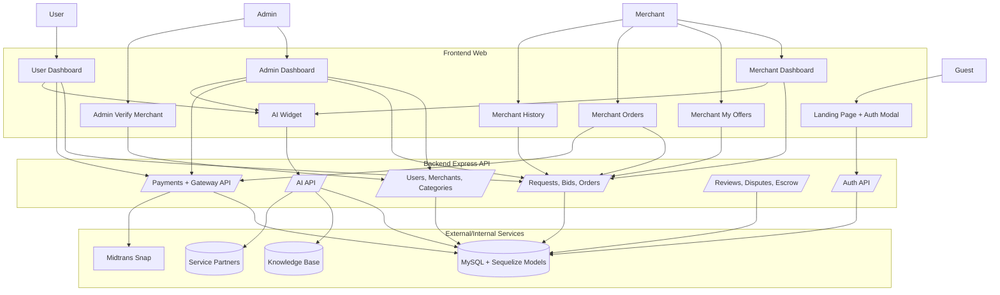
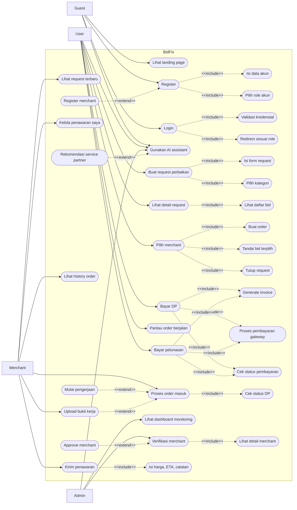
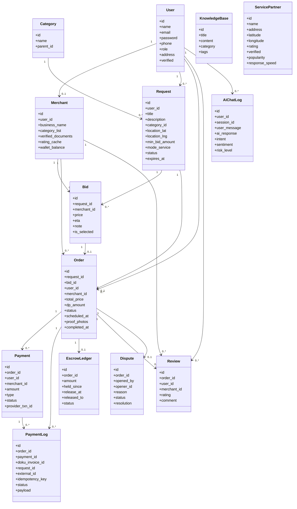
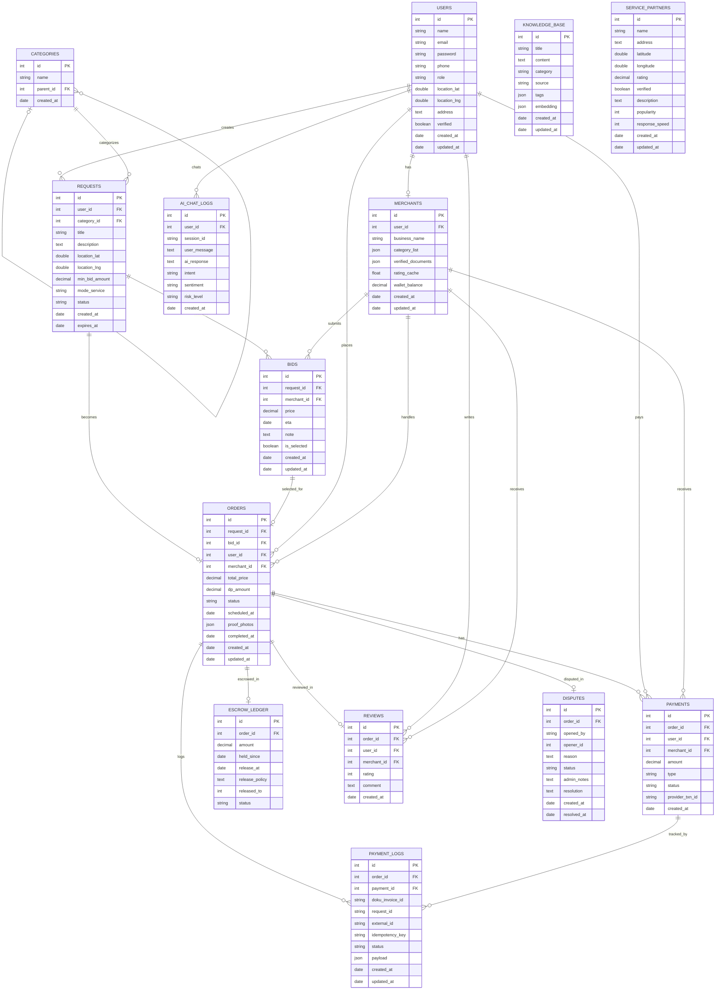
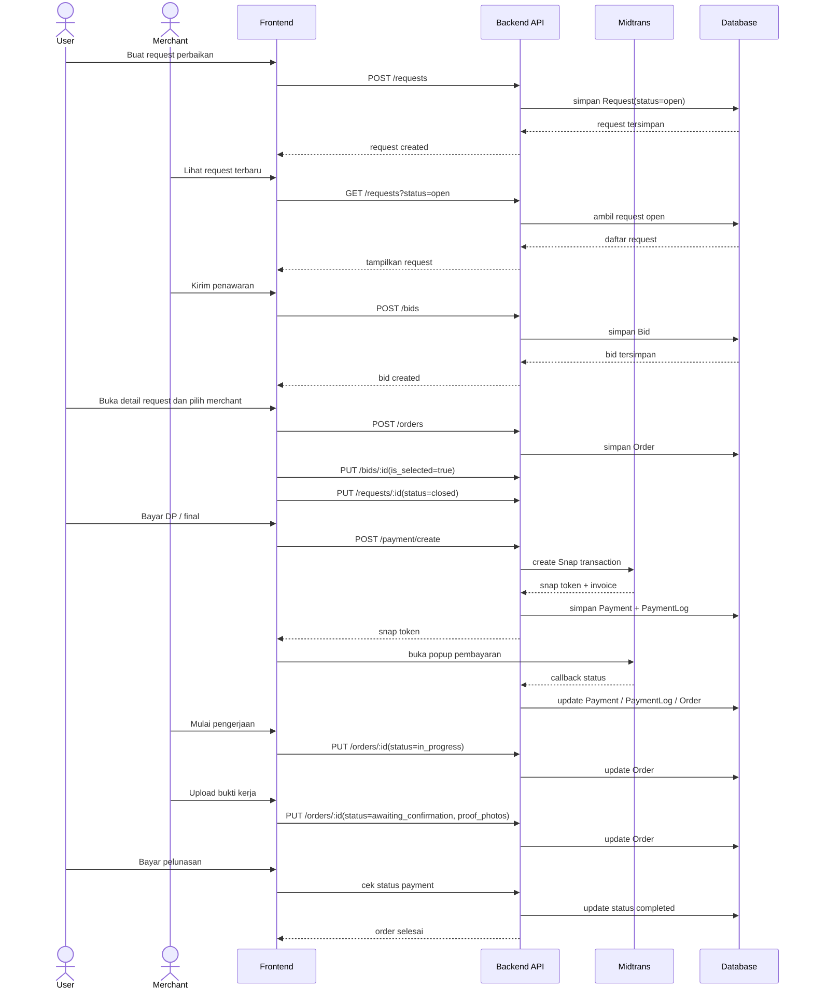
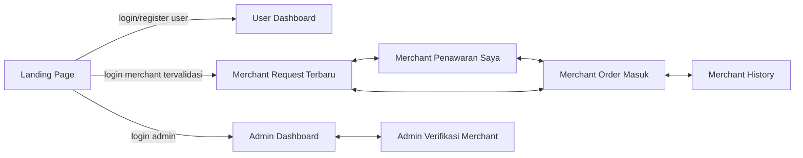
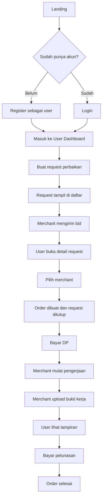
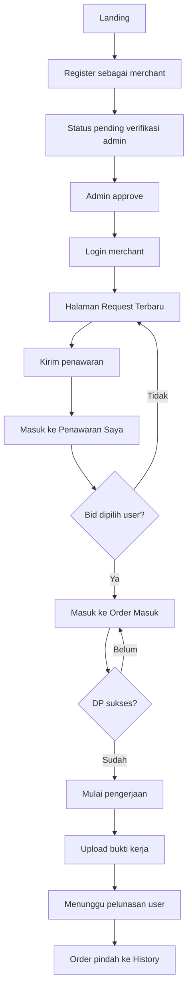
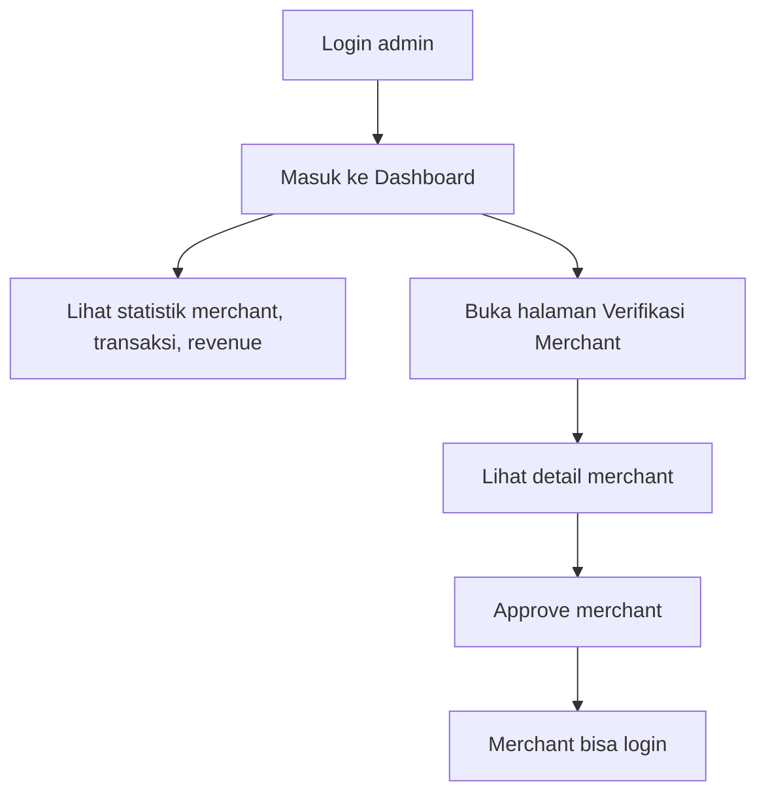
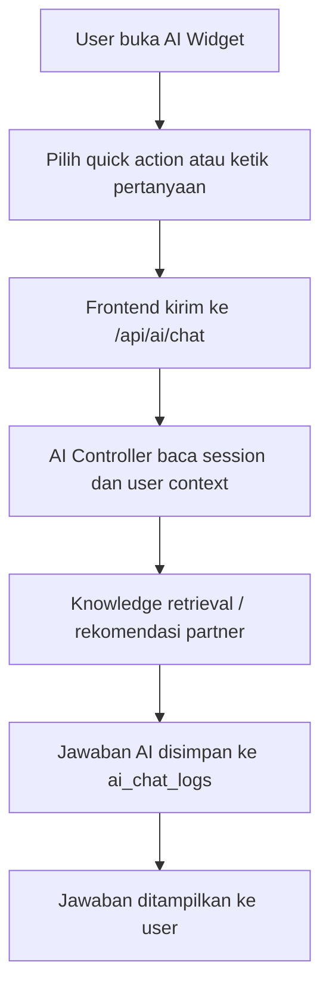

# BidFix: UML, Struktur Navigasi, dan User Flow

Dokumen ini dibuat dari implementasi yang ada saat ini di folder `frontend/` dan `backend/`.

## Ringkasan Aplikasi

BidFix adalah marketplace jasa perbaikan berbasis web dengan 3 role utama:

- `user`: membuat request perbaikan, memilih merchant, dan melakukan pembayaran
- `merchant`: melihat request, mengirim penawaran, mengerjakan order, dan upload bukti kerja
- `admin`: memantau sistem dan memverifikasi merchant

Komponen pendukung yang sudah ada di codebase:

- AI Assistant
- payment gateway Midtrans
- model escrow, dispute, review, knowledge base, dan service partner

Catatan implementasi:

- fitur `review`, `dispute`, dan `escrow` sudah ada di backend/model, tetapi belum ditemukan halaman frontend khusus
- tombol `Reject` pada halaman verifikasi admin belum menyimpan status reject ke backend; yang persisten baru `Approve`

## 1. UML Arsitektur Sistem



## 2. UML Use Case

Catatan:

- di UML, relasi standar yang dipakai adalah `<<include>>` dan `<<extend>>`
- kalau yang dimaksud "exclude", biasanya dalam diagram use case yang benar adalah `<<extend>>`



### 2.1 Relasi Include dan Extend

#### Include

- `Register` `<<include>>` `Isi data akun`
- `Register` `<<include>>` `Pilih role akun`
- `Login` `<<include>>` `Validasi kredensial`
- `Login` `<<include>>` `Redirect sesuai role`
- `Buat request perbaikan` `<<include>>` `Isi form request`
- `Buat request perbaikan` `<<include>>` `Pilih kategori`
- `Lihat detail request` `<<include>>` `Lihat daftar bid`
- `Pilih merchant` `<<include>>` `Buat order`
- `Pilih merchant` `<<include>>` `Tandai bid terpilih`
- `Pilih merchant` `<<include>>` `Tutup request`
- `Bayar DP` `<<include>>` `Generate invoice`
- `Bayar DP` `<<include>>` `Proses pembayaran gateway`
- `Bayar DP` `<<include>>` `Cek status pembayaran`
- `Bayar pelunasan` `<<include>>` `Generate invoice`
- `Bayar pelunasan` `<<include>>` `Proses pembayaran gateway`
- `Bayar pelunasan` `<<include>>` `Cek status pembayaran`
- `Kirim penawaran` `<<include>>` `Isi harga, ETA, catatan`
- `Proses order masuk` `<<include>>` `Cek status DP`
- `Verifikasi merchant` `<<include>>` `Lihat detail merchant`

#### Extend

- `Register merchant` `<<extend>>` `Register`
- `Rekomendasi service partner` `<<extend>>` `Gunakan AI assistant`
- `Mulai pengerjaan` `<<extend>>` `Proses order masuk`
- `Upload bukti kerja` `<<extend>>` `Proses order masuk`
- `Approve merchant` `<<extend>>` `Verifikasi merchant`

## 3. UML Class Diagram



## 4. ERD



Catatan ERD:

- `knowledge_base` dan `service_partners` saat ini berdiri sendiri dan dipakai oleh service AI
- `escrow_ledger`, `reviews`, dan `disputes` sudah punya tabel dan relasi, tetapi UI frontend-nya belum lengkap

## 5. UML Sequence Diagram: Alur Bisnis Utama



## 6. Struktur Navigasi

### 6.1 Peta Navigasi Global

```text
BidFix
|-- Landing Page
|   |-- Login Modal
|   |-- Register Modal
|   `-- AI Widget
|
|-- User
|   `-- Dashboard
|       |-- Form Buat Request
|       |-- Yang Sedang Berjalan
|       |-- Daftar Request
|       |-- Detail Request Modal
|       |-- Pilih Merchant Modal
|       |-- Payment / Pelunasan Modal
|       |-- Action / Confirmation Modal
|       `-- AI Widget
|
|-- Merchant
|   |-- Request Terbaru
|   |   |-- Detail Request Modal
|   |   `-- AI Widget
|   |-- Penawaran Saya
|   |   `-- Detail Penawaran Modal
|   |-- Order Masuk
|   |   `-- Upload Bukti Kerja Modal
|   `-- History
|       `-- Detail History Modal
|
`-- Admin
    |-- Dashboard
    |   `-- AI Widget
    `-- Verifikasi Merchant
        `-- Detail Verifikasi Modal
```

### 6.2 Diagram Navigasi Antar Halaman



## 7. User Flow

### 7.1 User Flow: User



### 7.2 User Flow: Merchant



### 7.3 User Flow: Admin



### 7.4 User Flow: AI Assistant



## 8. Ringkasan Struktur Navigasi per Role

### Guest

- landing page
- login modal
- register modal
- AI widget

### User

- dashboard tunggal
- create request
- detail request dan pilih merchant
- running orders
- pembayaran DP / pelunasan
- AI widget

### Merchant

- request terbaru
- penawaran saya
- order masuk
- history

### Admin

- dashboard monitoring
- verifikasi merchant
